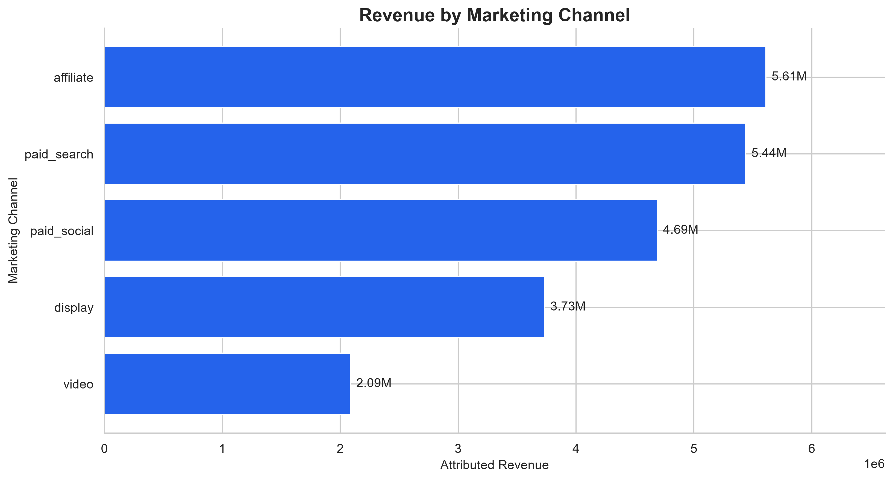
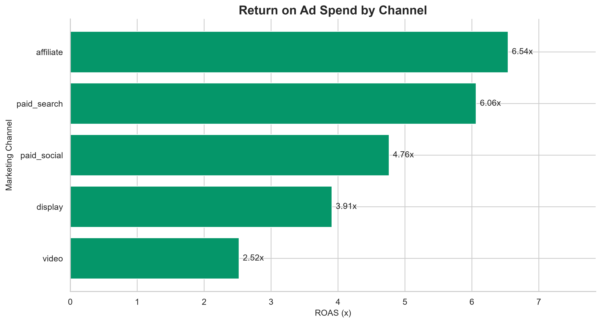
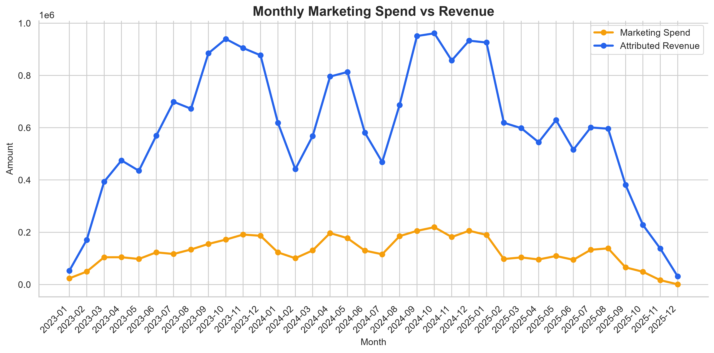
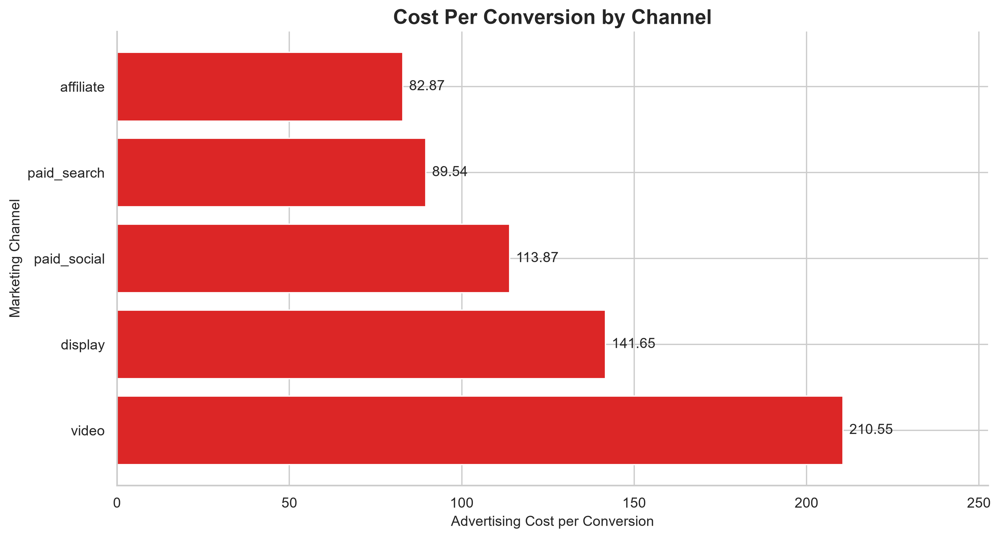
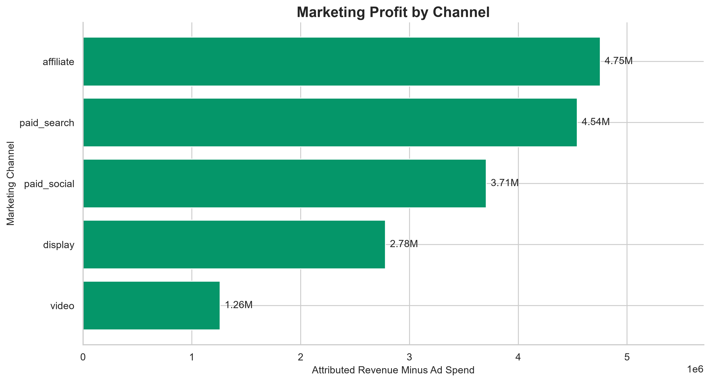
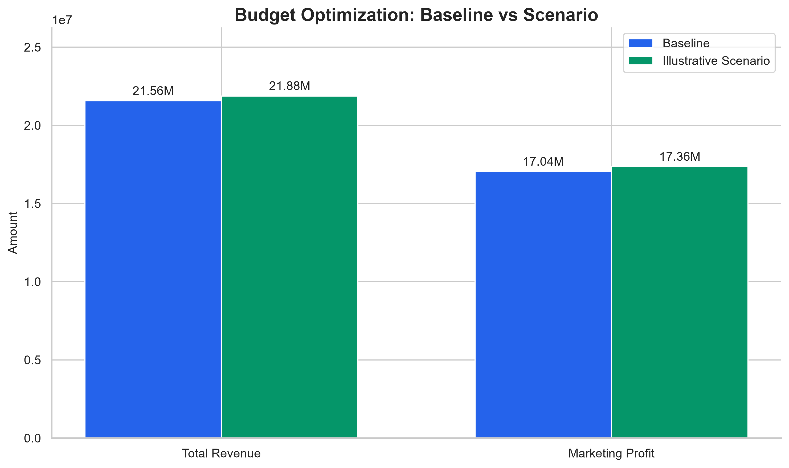

# MARKETING_PROFITABILITY
### Marketing Campaign Profitability Analysis & Budget Optimization

**End-to-End Data Analyst Portfolio Project**

**Tech Stack:** Excel | MySQL | Python | Pandas | NumPy | Matplotlib | Seaborn

---

## 1. Project Overview

MARKETING_PROFITABILITY is an end-to-end data analytics project focused on evaluating digital marketing performance, customer acquisition, attributed revenue, profitability, and advertising budget optimization.

The project analyzes **120 marketing campaigns across five advertising channels**, using Excel, SQL, and Python to transform marketing data into actionable business insights.

## 2. Business Problem

Marketing teams invest across multiple advertising channels, but higher spending does not always generate better financial returns.

This project addresses the following questions:

- Which marketing channels generate the highest revenue and profit?
- Which channels deliver the best return on ad spend (ROAS)?
- How efficiently are marketing leads converted?
- Which channels have high acquisition costs?
- How can marketing budgets be optimized without increasing total spending?

## 3. Project Objectives

- Analyze advertising spend and campaign performance.
- Measure engagement, leads, and conversion efficiency.
- Calculate marketing KPIs and profitability.
- Identify high-performing and inefficient channels.
- Evaluate budget reallocation opportunities.
- Present insights through charts and business reports.

## 4. Dataset Overview

The project uses four interconnected datasets.

| Dataset | Records | Description |
|---|---:|---|
| Campaigns | 120 | Campaign information and budgets |
| Daily Spend | 11,240 | Advertising spend, impressions, clicks |
| Leads | 261,684 | Lead generation information |
| Conversions | 39,696 | Conversion events and attributed revenue |

**Relationships:** Campaign ID connects campaign, spend, and lead data. Lead ID connects leads with conversions.

[View Data Dictionary](01_Dataset/data_dictionary/data_dictionary.md)

## 5. Tools and Technologies

| Technology | Purpose |
|---|---|
| Microsoft Excel | KPI calculations, analysis, charts |
| MySQL | Data validation, joins, analytical queries |
| Python | Data cleaning and analytical automation |
| Pandas and NumPy | Data processing and calculations |
| Matplotlib and Seaborn | Data visualization |
| PowerPoint | Business presentation |
| VS Code | Project development |

## 6. Project Workflow

1. **Data Collection:** Organized four marketing datasets.
2. **Data Validation:** Checked missing values, duplicates, and relationships.
3. **Data Cleaning:** Standardized dates, identifiers, and numeric fields.
4. **Exploratory Analysis:** Analyzed marketing spending and conversion patterns.
5. **KPI Analysis:** Calculated CTR, CPC, ROAS, conversion rates, and costs.
6. **Profitability Analysis:** Evaluated campaign and channel financial performance.
7. **Budget Optimization:** Modeled an illustrative budget reallocation.
8. **Reporting:** Created visualizations, reports, and a PowerPoint presentation.

## 7. Executive Marketing KPIs

| KPI | Result |
|---|---:|
| Total Advertising Spend | 4,523,050.02 |
| Total Attributed Revenue | 21,561,839.01 |
| Marketing Profit | 17,038,788.99 |
| ROAS | 4.77x |
| Marketing ROI | 376.71% |
| Marketing Profit Margin | 79.02% |
| Total Leads | 261,684 |
| Total Conversions | 39,696 |
| Lead Conversion Rate | 15.17% |
| Advertising Cost per Conversion | 113.94 |

*Marketing profit = attributed revenue − advertising spend. Other business costs are excluded.*

## 8. Marketing Channel Performance

| Channel | Spend | Revenue | Marketing Profit | ROAS |
|---|---:|---:|---:|---:|
| Affiliate | 857,835.07 | 5,610,700.73 | 4,752,865.66 | 6.54x |
| Paid Search | 897,091.53 | 5,439,329.35 | 4,542,237.82 | 6.06x |
| Paid Social | 984,731.88 | 4,690,137.28 | 3,705,405.40 | 4.76x |
| Display | 955,297.00 | 3,734,117.43 | 2,778,820.43 | 3.91x |
| Video | 828,094.54 | 2,087,554.22 | 1,259,459.68 | 2.52x |

## 9. Key Business Insights

**1. Affiliate – Highest Profitability**

Affiliate achieved the highest ROAS (6.54x), generating approximately 4.75 million in marketing profit.

**2. Paid Search – Strong Acquisition Performance**

Paid Search achieved the highest CTR (3.49%) and lead conversion rate (15.35%), with a ROAS of 6.06x.

**3. Paid Social – Optimization Opportunity**

Paid Social generated approximately 4.69 million in revenue with a ROAS of 4.76x.

**4. Display – Lower Engagement**

Display recorded the lowest CTR (0.60%) and a ROAS of 3.91x.

**5. Video – Highest Acquisition Cost**

Video achieved the lowest ROAS (2.52x) and highest advertising cost per conversion (210.55).

## 10. Budget Optimization Scenario

An illustrative scenario reallocates 10% of Video advertising spend to historically stronger channels.

| Channel | Budget Adjustment |
|---|---:|
| Video | -82,809.45 |
| Affiliate | +49,685.67 |
| Paid Search | +33,123.78 |
| Net Budget Change | 0.00 |

**Objective:** Explore opportunities to improve marketing returns while maintaining the existing advertising budget.

*The model assumes historical ROAS remains constant. Results are illustrative, not guaranteed forecasts.*

## 11. Data Visualizations

### Revenue by Marketing Channel


### Return on Ad Spend


### Monthly Spend vs Revenue


### Advertising Cost per Conversion


### Marketing Profit by Channel


### Budget Optimization Comparison


[View All Eight Visualizations](05_Visualizations/)

## 12. Project Structure

```text
MARKETING_PROFITABILITY/
├── 01_Dataset/         # Raw and cleaned datasets
├── 02_Excel/           # Excel analysis workbook
├── 03_SQL/             # SQL analysis scripts
├── 04_Python/          # Python scripts and outputs
├── 05_Visualizations/  # Eight analytics charts
├── 06_Reports/         # Business analysis reports
├── 07_Presentation/    # PowerPoint presentation
├── 08_Documentation/   # Technical documentation
├── 09_Database/        # Database resources
└── README.md
```

## 13. Reports and Presentation

**Business Reports**

- [Executive Summary](06_Reports/01_executive_summary.md)
- [Marketing Performance Report](06_Reports/02_marketing_performance_report.md)
- [Budget Optimization Report](06_Reports/03_budget_optimization_report.md)
- [Business Recommendations](06_Reports/04_business_recommendations.md)

**Project Presentation**

[View PowerPoint Presentation](07_Presentation/Marketing_Profitability_Project_Presentation.pptx)

## 14. Business Recommendations

- Evaluate controlled budget expansion for Affiliate and Paid Search.
- Improve Paid Social targeting and campaign performance.
- Investigate Display and Video advertising efficiency.
- Monitor ROAS, conversion rates, and acquisition costs.
- Validate budget changes through incremental performance testing.

## Dataset Source & Attribution

This project uses the **Marketing Campaigns & Conversions Dataset v1.0.0**, a synthetic educational dataset created by Analytics Engineering.

**Dataset Attribution:** Analytics Engineering, *Marketing Campaigns & Conversions Dataset v1.0.0*.

- **Source:** https://www.analyticsengineering.com/datasets/marketing-campaigns
- **License:** [Creative Commons Attribution 4.0 International (CC BY 4.0)](https://creativecommons.org/licenses/by/4.0/)
- **Data Type:** Synthetic educational dataset.

The original dataset has been cleaned, transformed, and analyzed for this portfolio project. Derived metrics, visualizations, SQL queries, Python scripts, and analytical reports were developed as part of the project.

The dataset does not represent real individuals or organizations, and the analytical findings should not be treated as industry benchmarks.

## 15. Conclusion

The project demonstrates an end-to-end marketing analytics workflow using Excel, SQL, and Python.

Affiliate and Paid Search emerged as the strongest historical channels based on ROAS and acquisition efficiency.

The analysis illustrates how integrated marketing data can support campaign evaluation, profitability measurement, and evidence-based budget allocation decisions.

**Project Category:** Data Analytics | Marketing Analytics | Business Intelligence | Budget Optimization